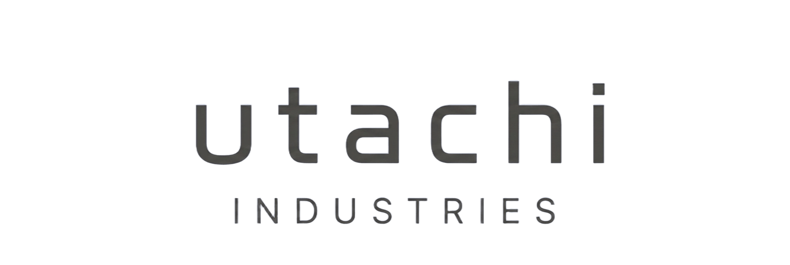

<p align="center">
  
</p>

<h1 align="center">Ultorn</h1>
<p align="center">Sovereign Cybersecurity Platform, a Utachi Industries Labs product</p>

<p align="center">
  
  
  
  
  
</p>

A West African-owned cybersecurity and digital-trust infrastructure platform.
Defensive-only. No verification gate for sandbox testing. Full data extraction.

Built by [Utachi Industries](https://www.utachiindustries.space/), a Dakar, Senegal-based
studio ("nous bâtissons des marques") spanning brand/product design (Studio) and
digital products, automation, and AI (Labs). Ultorn is a Labs project.

## What this is

MVP backend (FastAPI + SQLAlchemy + SQLite) + frontend (Next.js) implementing:

- **Client onboarding** with scoped authorization agreements
- **Scan scopes**: add targets (domains, IPs, URLs) per client
- **Vulnerability scanning** with full data extraction: HTTP headers, server banners,
  page titles, response bodies, Nmap service detection, Nuclei template matching
- **No verification gate**: scans run on all non-excluded scopes immediately
- **Findings + human review**: critical/high findings require named analyst attestation
- **AI sovereignty layer**: prompt sanitization (client names, IPs, credentials, PII stripped),
  model-abstraction (Anthropic/OpenAI swappable), local fallback, immutable AI query audit log
- **Immutable audit log**: every action, scan, AI query, and review logged
- **Admin panel**: manage user roles/access and issue/revoke API keys for programmatic access
- **Marketing landing page**: dark full-viewport hero at `/`, with the operator console at `/console`

## Quick Start

### Prerequisites
- Python 3.9+
- Node.js 20+
- Docker (optional)

### Backend

```bash
cd backend
cp .env.example .env
pip install -r requirements.txt
uvicorn app.main:app --reload --host 0.0.0.0 --port 8000
```

The API will be at `http://localhost:8000`. Interactive docs at `http://localhost:8000/docs`.

Default admin: `admin@ultorn.local` / `admin123`

### Frontend

```bash
cd frontend
npm install
npm run dev
```

Frontend at `http://localhost:3000`. Set `NEXT_PUBLIC_API_URL=http://localhost:8000`.

- `/`: marketing landing page (sign-in entry point)
- `/console`: the operator app (dashboard, clients, scans, findings, AI guard, audit, admin)

### Docker

```bash
docker-compose up --build
```

## Core Design Boundaries

1. **No offensive capability.** Scanners find and report exposures only. No exploitation,
   no data exfiltration beyond banner/header/body extraction, no lateral movement.
2. **No autonomous exploitation.** Critical/high findings require named human analyst review.
3. **No single foreign AI dependency.** Model-abstraction layer lets you swap providers.
   `force_local` keeps sensitive prompts on-premises.
4. **Full audit trail.** Every action, scan, AI query, and review immutably logged.

## Key API Endpoints

| Method | Endpoint | Description |
|--------|----------|-------------|
| POST | `/auth/token` | Login (JWT) |
| GET | `/auth/me` | Current authenticated user |
| POST | `/auth/register` | Register user |
| GET/POST | `/clients` | Client management |
| POST | `/clients/{id}/scopes` | Add scan target |
| POST | `/scopes/{id}/verify` | Verify ownership (optional) |
| POST | `/scans` | Create a scan |
| POST | `/scans/{id}/run` | Run scan (no verification gate) |
| GET | `/scans/{id}/findings` | Get findings with extracted evidence |
| POST | `/findings/{id}/review` | Human analyst review |
| POST | `/ai/query` | Sanitized AI query (logged) |
| GET | `/ai/audit` | AI query audit log |
| GET | `/audit` | Full audit log |
| POST | `/sanitize` | Preview sanitization |
| GET | `/health` | Health check |
| GET | `/admin/users` | List users (admin) |
| PATCH | `/admin/users/{id}` | Update a user's role / active status (admin) |
| GET | `/admin/api-keys` | List API keys (admin) |
| POST | `/admin/api-keys` | Mint an API key, raw key shown once (admin) |
| DELETE | `/admin/api-keys/{id}` | Revoke an API key (admin) |

API keys authenticate like a user session: send `X-API-Key: <key>` instead of a `Bearer` JWT
on any endpoint, scoped to the admin account that minted the key.

## File Layout

```
backend/
  app/
    __init__.py
    config.py        # Settings (Pydantic, env-backed)
    database.py      # SQLAlchemy engine + session
    models.py        # DB models (User, Client, ScanScope, Scan, Finding, AuditLog, AIQueryLog, APIKey)
    schemas.py       # Pydantic request/response schemas
    auth.py          # JWT auth + role-based access control
    sanitizer.py     # PII/IP/credential stripping (sovereignty layer)
    scanner.py       # Nuclei + Nmap + HTTP extraction engine
    ai_router.py     # AI routing w/ sanitization + audit logging
    audit.py         # Immutable audit-log writer
    main.py          # FastAPI app + all routes
    worker.py        # Background scan worker (Celery)
  Dockerfile
  requirements.txt
  .env.example

frontend/
  src/app/page.tsx              # Marketing landing page (hero, video bg, entrance animation)
  src/app/hero.css              # Landing-page design system (reference-pixel --u scaling)
  src/app/marketing-page.css    # Shared dark theme for subpages + console login
  src/app/console/page.tsx      # Operator app (dashboard, clients, scans, findings, AI, audit, admin)
  src/app/{platform,scanning,sovereignty,contact,privacy-notice,service-agreement}/page.tsx
  src/content/site.ts           # Single source of truth for nav links + all marketing copy
  src/components/               # MarketingNav, MarketingFooter, MarketingPageShell, Arrow
  public/brand/                 # Utachi Industries logo (dark + white variants)
  public/media/                 # Locally-hosted, compressed hero background video + poster
  Dockerfile
  package.json
  next.config.js

.github/workflows/ci.yml   # Backend import check + frontend build, on push/PR
docker-compose.yml
TODO.md
README.md
```

## About Utachi Industries

[Utachi Industries](https://www.utachiindustries.space/) builds brands, products, and
companies from scratch out of Dakar, Senegal, working remotely and globally across two
divisions:

- **Studio**: branding, identity, UI/UX, fashion
- **Labs**: websites, SaaS, automation, and AI (Ultorn is a Labs product)

Contact: [WhatsApp +221 78 108 05 06](https://wa.me/221781080506) · [@utachiindustries](https://instagram.com/utachiindustries)

## Roadmap

See [TODO.md](TODO.md) for what's done and what's left.
